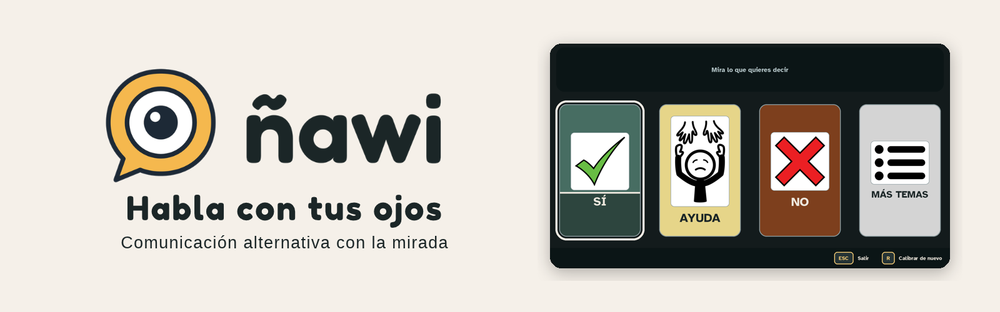
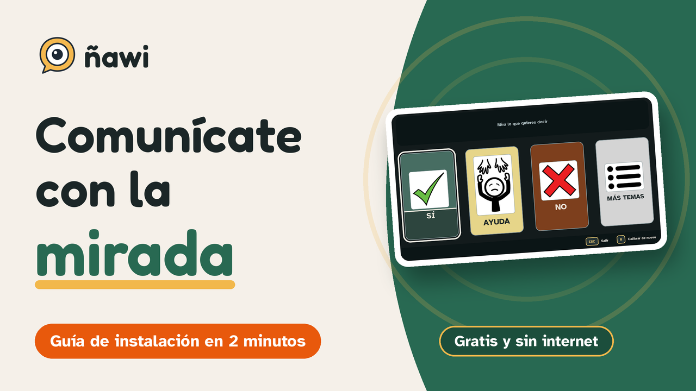
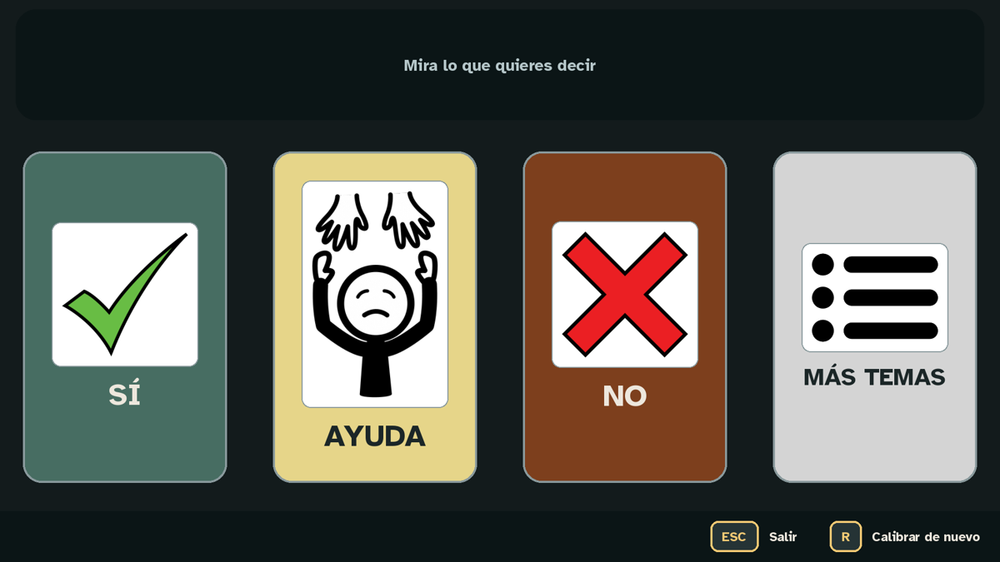
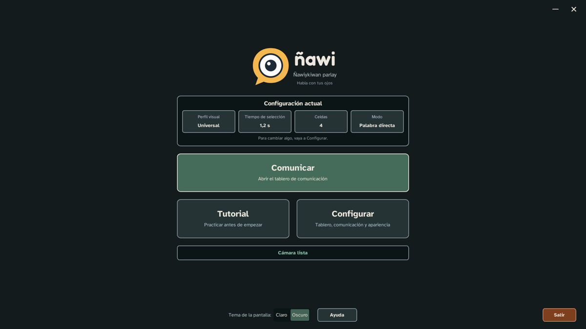
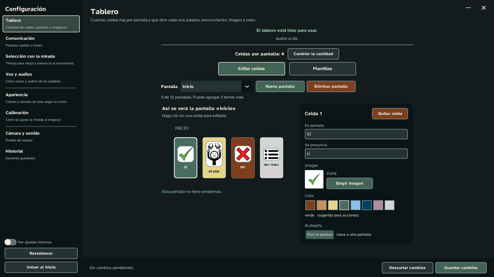
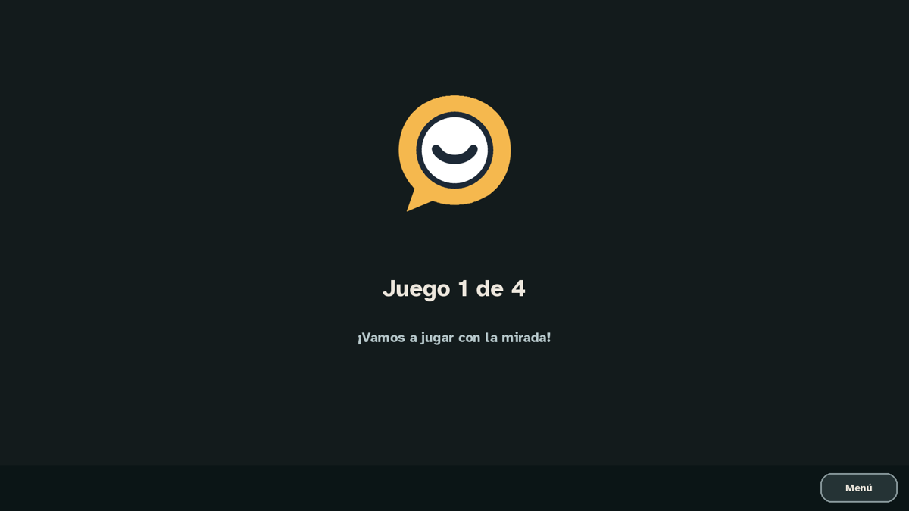

  

  <a href="../../releases/latest/download/Nawi_instalador.exe"><b>Descargar para Windows</b></a>
  &nbsp;&nbsp;  &nbsp;&nbsp;
  <a href="../../releases/latest/download/Manual_de_uso_Nawi.pdf"><b>Manual de uso</b></a>
  &nbsp;&nbsp;  &nbsp;&nbsp;
  <a href="https://youtu.be/qmSS_YJhY3A"><b>Ver el video</b></a>

**Ñawi** es un programa de comunicación alternativa con la mirada. La persona elige pictogramas del tablero mirándolos, y el programa dice la palabra en voz alta. Solo hace falta una computadora con Windows y una cámara web común.

## Video: de la descarga a la primera sesión

  

## Cómo se ve

| Tablero | Pantalla de inicio |
|---|---|
|  |  |
| Configurar | Tutorial |
|  |  |

## Descargar

| | |
|---|---|
| **Instalador para Windows** | [Nawi_instalador.exe](../../releases/latest/download/Nawi_instalador.exe) |
| **Manual de uso (PDF)** | [Manual_de_uso_Nawi.pdf](../../releases/latest/download/Manual_de_uso_Nawi.pdf) |
| **Guía rápida (1 página)** | [Guia_rapida_Nawi.pdf](../../releases/latest/download/Guia_rapida_Nawi.pdf) |

Los enlaces siempre bajan la última versión. Las versiones anteriores y sus cambios están en [Versiones](../../releases).

El instalador ya trae todo lo necesario, incluidos el manual y la guía rápida. No necesita Python ni internet para instalar ni para usar Ñawi.

> Al abrir el instalador, Windows puede mostrar «Windows protegió su PC», porque el programa no tiene firma comercial. Pulse **Más información** y luego **Ejecutar de todas formas**.

## Es un prototipo

Ñawi es un prototipo de investigación, desarrollado como proyecto de grado. No es un dispositivo médico, no reemplaza la evaluación de un profesional y no debe ser el único medio para avisar de una urgencia. Úselo siempre con un adulto presente.

## Qué necesita el usuario

- Mover los ojos de un lado a otro cuando quiere.
- Mirar un dibujo y sostener la mirada uno o dos segundos.
- Mantener la cabeza bastante quieta, solo o con un apoyo.
- Ver los pictogramas desde donde está sentado.
- Entender que, al mirar algo, pasa algo.

No es adecuado si hay movimientos involuntarios de los ojos o de la cabeza que no dejan ver la cara con la cámara. Para saber si le sirve, hagan juntos el Tutorial del programa: si la calibración distingue al menos dos celdas, puede usar el tablero de SÍ y NO.

## Qué necesita la computadora

| | |
|---|---|
| Sistema | Windows 10 u 11 de 64 bits |
| Procesador | 4 hilos, unos 2 GHz (por ejemplo Intel Core i3 de 8.ª generación o AMD Ryzen 3 serie 3000) |
| Memoria | 4 GB (se recomiendan 8 GB) |
| Disco | alrededor de 1 GB libre |
| Cámara | cámara web de 30 cuadros por segundo |
| Pantalla | 1280 x 720 o mayor |
| Internet | no hace falta |

## Contacto

Nataly S. Romero J., [nsromero.j@gmail.com](mailto:nsromero.j@gmail.com)

Si algo no funciona, escriba desde la Ayuda del programa («Si algo no funciona») y adjunte el archivo `errores.log` de la carpeta `datos` de Ñawi.

## Licencia

Ñawi se distribuye con la licencia [CC BY-NC-SA 4.0](https://creativecommons.org/licenses/by-nc-sa/4.0/deed.es): se puede usar, copiar, compartir y modificar, sin fines comerciales, citando a la autora y con la misma licencia. Los pictogramas son de [ARASAAC](https://arasaac.org) (Sergio Palao, Gobierno de Aragón). El detalle completo, con los íconos y las tipografías, está en [LICENCIA.txt](LICENCIA.txt).
